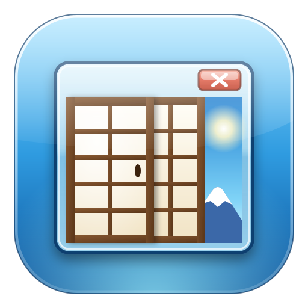

<p align="center"></p>

# shojiwm-win7

Site: <https://sachahjkl.github.io/shojiwm-win7/>

A Windows 7 "Aero" desktop for [ShojiWM](https://github.com/bea4dev/ShojiWM),
the Wayland compositor you configure in TypeScript.

The compositor draws the window frames: a blurred glass caption bar, the
caption buttons at the top right, and a thin glossy border. A
[Quickshell](https://quickshell.org) shell draws the rest of the desktop: the
taskbar, the Start menu and the wallpaper.

No file from Windows is copied, embedded or required. The artwork is
original, except the colour icons of the desktop, the Start menu and the jump
lists, which are built from KDE's LGPL-licensed Oxygen icons (see "Licence").

## What you get

|                           |                                                                                                                                                                                                                                                                                                                                                                                                                                                                                                                                                                                                                                                                                                                                                                                                |
| ------------------------- | ---------------------------------------------------------------------------------------------------------------------------------------------------------------------------------------------------------------------------------------------------------------------------------------------------------------------------------------------------------------------------------------------------------------------------------------------------------------------------------------------------------------------------------------------------------------------------------------------------------------------------------------------------------------------------------------------------------------------------------------------------------------------------------------------- |
| **Glass window frames**   | The compositor blurs what is behind the caption bar, the taskbar and the menus, at the strength the Control Panel sets (Clear to Frosted), and tints the caption bar blue-grey. A drawn sheen lies over the blur. The focused window has a stronger tint, a lighter outline and a deeper shadow. All four corners are rounded, 8 px, and the lines round it are translucent black and white, so they take the colour of what is behind. The caption bars', the taskbar's and the Start menu's glass take a colour from a palette of fifteen, at an intensity you set, as Windows 7's Window Color does.                                                                                                                                                                                        |
| **Caption buttons**       | Minimise, maximise or restore, and a wider close button. Each one lights up under the pointer; the close button glows red. A label appears when the pointer rests on one.                                                                                                                                                                                                                                                                                                                                                                                                                                                                                                                                                                                                                      |
| **Floating windows**      | Every window floats. A program's new window opens where its last one closed; other new windows open in a cascade in the middle of the screen.                                                                                                                                                                                                                                                                                                                                                                                                                                                                                                                                                                                                                                                  |
| **Fast animations**       | Windows open in 140 ms and close in 110 ms. Minimise and restore take 130 ms.                                                                                                                                                                                                                                                                                                                                                                                                                                                                                                                                                                                                                                                                                                                  |
| **Alt+Tab**               | A panel of live thumbnails over the desktop. Tab, the arrow keys and the pointer pick a window.                                                                                                                                                                                                                                                                                                                                                                                                                                                                                                                                                                                                                                                                                                |
| **Aero Snap**             | Drag a window against the top, left or right edge, or hold `Super` and press an arrow key. While you drag, a rectangle shows the place the window will take.                                                                                                                                                                                                                                                                                                                                                                                                                                                                                                                                                                                                                                   |
| **Double click**          | On the caption bar: maximise, and again to restore.                                                                                                                                                                                                                                                                                                                                                                                                                                                                                                                                                                                                                                                                                                                                            |
| **Taskbar**               | Glass bar at the bottom: the orb, glass buttons that fill its height (icons alone by default, as Windows 7 does; labels in the Control Panel), the notification area, the clock over the full date, and the show-desktop button at the far right. Auto-hide (Taskbar and Start menu) slides it down to a 2 px line that brings it back, and keeps it up while one of its menus is open.                                                                                                                                                                                                                                                                                                                                                                                                        |
| **Sticky notes**          | Desktop menu, New, Sticky Note: a yellow note on the desktop to type in, moved by its band, sized by its corner, with + for another and × to remove it. The notes are kept in `~/.local/state/shojiwm-win7/notes.json`. The desktop holds the keyboard while you type in one and gives it back when the pointer goes to a window.                                                                                                                                                                                                                                                                                                                                                                                                                                                              |
| **Gadgets**               | On the first screen's desktop: the CPU Meter, two dials for the processor and the memory in use read from `/proc` every 1.5 s, and the Clock, an analog face with a seconds hand and the day. Drag them anywhere; the desktop menu's Gadgets submenu shows or hides each.                                                                                                                                                                                                                                                                                                                                                                                                                                                                                                                      |
| **Desktop icons**         | The Recycle Bin and everything in the desktop folder, on the top left screen to start with. Drag an icon anywhere, on any screen; View → Align icons to grid snaps it to a cell, Auto arrange icons fills each screen's columns in sort order. The icons of a screen that is not connected show on the main one and go back when it returns. Click to pick, Ctrl+click or drag a box for several, double click to open; a `.desktop` file is a shortcut with the arrow. Right click an icon to open, delete or rename it; right click the desktop for View, Sort by, Refresh, New folder or text document, a terminal there, and Personalize. Computer, your files and the Control Panel can stand beside the Recycle Bin (Taskbar and Start menu, Desktop icons); Computer does by default.   |
| **Pinned programs**       | A pinned program keeps its icon on the taskbar while it is closed; a click starts it. Once it runs, its windows gather behind that same button. A middle click, Ctrl+click or Shift+click on any button starts another instance; clicks while a program starts do not start it again.                                                                                                                                                                                                                                                                                                                                                                                                                                                                                                          |
| **Button progress**       | A program's progress fills its taskbar button green, as Windows 7 shows a download; a count shows in a red badge, and an urgent program turns its button orange. Programs send these with the `com.canonical.Unity.LauncherEntry` signal (Chromium, Firefox, KDE and GTK programs).                                                                                                                                                                                                                                                                                                                                                                                                                                                                                                            |
| **Combined buttons**      | Every window of one program sits behind one button, drawn as a stack. One setting in `shell/theme.js` gives one button per window instead.                                                                                                                                                                                                                                                                                                                                                                                                                                                                                                                                                                                                                                                     |
| **Window thumbnails**     | Rest on a taskbar button and its windows are listed with their titles. A click raises one, a middle click closes it. The live picture of each window is written but off; see "Real limits". A media player's thumbnails carry its toolbar, as on Windows 7: previous, play or pause, and next, through MPRIS. A thumbnail under the pointer shows a red close button at its top right.                                                                                                                                                                                                                                                                                                                                                                                                         |
| **Jump lists**            | Right click a taskbar button for the files the program opened last (from `recently-used.xbel`), the tasks of its `.desktop` file, a second instance, and close. A file's pin, at the right of its line under the pointer, keeps it in a Pinned section over the recent ones, in the taskbar's and the Start menu's jump lists.                                                                                                                                                                                                                                                                                                                                                                                                                                                                 |
| **Notification area**     | A tray item's own menu, drawn in the same style, with its submenus, check boxes and radio buttons. The bar's menus and panels stay open until a click outside them or a choice.                                                                                                                                                                                                                                                                                                                                                                                                                                                                                                                                                                                                                |
| **Launcher**              | `Super`+`Shift`+`D` opens the Start menu's search alone, on the focused screen. Before you type, it lists the programs you started last (25 by default, set in the Control Panel), then every program; as you type: programs (the one whose name starts with what you type first, then the one you start most), Control Panel tasks and files. Return starts the one picked, or runs what you typed. Drag its sides and bottom edge to resize it; it keeps the size, and a list of height 0 leaves the field alone.                                                                                                                                                                                                                                                                            |
| **Run dialog**            | `Super`+`R`, or Run... in the Start menu: the Open field with the last 26 commands, completion from them, and the list under its arrow. A folder, a file or an address opens with `xdg-open`; anything else runs in a shell. A program that is not found stays in the field, with a message under it.                                                                                                                                                                                                                                                                                                                                                                                                                                                                                          |
| **Start orb menu**        | A right click on the orb, or `Super`+`X`: terminals (one as root), the task manager, the Control Panel pages, the files, the network connections, the disks, the system log, the launcher, the power actions and the desktop.                                                                                                                                                                                                                                                                                                                                                                                                                                                                                                                                                                  |
| **Action Center**         | The flag of the notification area reports the problems that Windows 7's Action Center reports: system and user services that failed (systemd) and disks 90 % full, with a red or yellow mark. Its panel lists them; a failed service of yours can be cleared, a full disk opened. `quickshell ipc call actioncenter open\|close`.                                                                                                                                                                                                                                                                                                                                                                                                                                                              |
| **Notifications**         | The bell of the notification area keeps the notifications, across sessions, in `~/.local/state/shojiwm-win7/notifications.json` (Hokum draws them and keeps none): a red count for the unseen ones, a click for the list with each program's icon, title, text and time, a cross per card and Clear all. The panel's switch, or a middle click on the bell, is Hokum's Do not disturb, which slashes the bell.                                                                                                                                                                                                                                                                                                                                                                                 |
| **Network**               | The network icon beside the speaker shows a wired screen or wireless bars, with a yellow mark without Internet and a red one without a connection. A click opens the Windows 7 network panel: the connection in use, the wireless networks with their bars, Connect and Disconnect, the wireless switch and the connection editor. NetworkManager asks for a new network's key through its agent (nm-applet).                                                                                                                                                                                                                                                                                                                                                                                  |
| **Bluetooth**             | With a BlueZ adapter, a Bluetooth icon shows in the notification area, grey when Bluetooth is off. A click opens its panel: the adapter and its switch, the paired devices (connected ones first, with their battery), then the devices in reach. A click on a device offers Connect or Disconnect, Pair or Remove. `quickshell ipc call bluetooth open\|close`.                                                                                                                                                                                                                                                                                                                                                                                                                               |
| **Volume**                | The speaker beside the clock shows the level of the default output. A click opens the volume panel: a slider, the mute button and the link to the mixer (`pwvucontrol`). The wheel steps it by 2 %, a middle click mutes, and the media keys work. With more than one output, a click on the device's name lists them to switch. `quickshell ipc call volume open\|openDevices\|close` drives the panel.                                                                                                                                                                                                                                                                                                                                                                                       |
| **Screen zoom**           | `Super`+`Shift` and the wheel magnify the screen around the pointer; `Super`+`Shift`+`0` resets it.                                                                                                                                                                                                                                                                                                                                                                                                                                                                                                                                                                                                                                                                                            |
| **Additional clocks**     | Up to two more time zones, set in Date and Time with a field that offers the zones as you type, shown under the calendar and in the clock's tooltip with the day they are in.                                                                                                                                                                                                                                                                                                                                                                                                                                                                                                                                                                                                                  |
| **Calendar**              | Click the clock for the long date and a month, today framed, with arrows to the months around it.                                                                                                                                                                                                                                                                                                                                                                                                                                                                                                                                                                                                                                                                                              |
| **Screen saver**          | Mystify, drawn here: two bouncing shapes with fading trails, after 1 to 30 minutes without input (the idle protocol), until the mouse or a key; set and previewed on the Lock Screen page. Off by default, as on Windows 7.                                                                                                                                                                                                                                                                                                                                                                                                                                                                                                                                                                    |
| **Lock screen**           | The Windows 7 log-on screen: your picture behind (or the desktop's), the time, your account picture in its glass frame, your name, and the password field with the round blue arrow. `Super`+`L`, the Start menu, `loginctl lock-session`, going to sleep and a delay of inactivity lock it; PAM checks the password. It shows on the main screen only; the others stay black, and what is typed while one of them has the keyboard still goes to the password.                                                                                                                                                                                                                                                                                                                                |
| **Control Panel**         | A window laid out as the Windows 7 one: light or dark, desktop background, lock screen picture and delay, account picture, taskbar and Start menu, clock format. Every change applies at once.                                                                                                                                                                                                                                                                                                                                                                                                                                                                                                                                                                                                 |
| **Screen resolution**     | The Control Panel shows the screens as they are placed and sets the resolution, refresh rate and scale of each one, live. A change goes back on its own after 15 seconds unless you keep it. The choices replace `SHOJIWM_WIN7_OUTPUTS` for the screens you change.                                                                                                                                                                                                                                                                                                                                                                                                                                                                                                                            |
| **Devices and Printers**  | The Control Panel shows the computer, its screens, the USB devices (lsusb, hubs left out) with an icon that fits each, and the printers (CUPS) with a tick on the default one.                                                                                                                                                                                                                                                                                                                                                                                                                                                                                                                                                                                                                 |
| **Sound**                 | The Control Panel lists the playback and recording devices PipeWire knows, marks the default ones, and makes another the default; a link opens the volume mixer.                                                                                                                                                                                                                                                                                                                                                                                                                                                                                                                                                                                                                               |
| **Default programs**      | The Control Panel sets the program that opens web links, mail, folders, text, pictures, music, videos and PDF documents, from the programs whose .desktop file says they can, through xdg-mime (~/.config/mimeapps.list).                                                                                                                                                                                                                                                                                                                                                                                                                                                                                                                                                                      |
| **Startup programs**      | The Control Panel lists the XDG autostart entries the session starts: turn one off, restore a system entry, or add any installed program. Changes apply at the next log-on.                                                                                                                                                                                                                                                                                                                                                                                                                                                                                                                                                                                                                    |
| **Background slide show** | Desktop Background can change the picture on its own from a folder (your Pictures by default), every 1 minute to 1 day, in name order or shuffled, with a Next picture button. Picture position sets Fill, Fit, Stretch, Tile or Center, over Windows 7's dark blue.                                                                                                                                                                                                                                                                                                                                                                                                                                                                                                                           |
| **Light and dark**        | The system's own preference (`color-scheme`, which the settings portal passes to GTK, libadwaita, Qt, Firefox and Chromium). The menus, the Start menu and the Control Panel follow it too.                                                                                                                                                                                                                                                                                                                                                                                                                                                                                                                                                                                                    |
| **Aero Peek**             | Rest on the show-desktop strip at the far right and every window turns into a glass outline over the desktop. Click it to put the windows away; click again to bring them back.                                                                                                                                                                                                                                                                                                                                                                                                                                                                                                                                                                                                                |
| **Start menu**            | Pinned programs, then the ones you start most, and **All Programs** with every program in folders. Type to search; the arrow keys and Return pick a result, and Return with nothing found runs what you typed. On the right: your full name, your folders (as `xdg-user-dirs` names them), and a power button whose arrow offers log off, lock, restart, sleep and hibernate. Its search lists, under headings as Windows 7 does, the programs, the Control Panel tasks and the files of your home folder (fd). A program with recent files has an arrow; resting on it shows them in the right column, to open with it. Recent Items in the right column opens a submenu of the files used lately. Compact by default; Taskbar and Start menu → Use large icons gives Windows 7's large rows. |

## Screenshots

Every picture here is a capture of this configuration running. None is drawn
or mocked up. `tools/screenshots.sh` makes them on a machine with no display:
ShojiWM's nested backend inside an X server with no screen, Mesa rendering in
software, and the keys and the pointer driven by xdotool.


The wallpaper with its icons, two windows, and the taskbar: one combined
button for the two `foot` windows, the pinned `footclient` as an icon alone
since none of its windows is open, the notification area and the clock.


A right click on the desktop: the menu, with View open. The desktop icons are
on the left.


The frames, cut out of the picture above: the focused window on top with a
lighter outline, the other behind it.


The Start menu: the pinned programs on the left (`foot` and `footclient` here,
pinned by the capture script), your folders on the right, the search box at
the bottom and the power button with its arrow in the corner. The name at the
top is cut short with an ellipsis when it does not fit.


**All Programs**: every program in a folder named after its main category.
One folder opens at a time.


The arrow beside the power button: log off, lock, restart, sleep, hibernate.


A search that finds no program offers to run the text as a command.


Resting on a taskbar button lists the windows behind it, with their titles.
Each card carries the program's icon; see "Real limits" for why it is not a
live picture of the window.


A right click on the same button: the files the program opened last, then
the program itself and "Close all windows". `foot` declares no tasks in its
`.desktop` file, so there is no "Tasks" section. Nothing on the test machine
opens files through GTK, so `tools/screenshots.sh` writes the
`recently-used.xbel` the list is read from, naming `foot`; and since Thunar,
Chromium and kitty are not installed there, it pins `foot` and `footclient`
instead.


The menu of a tray item, drawn in the same style.


Dragging a window against the left edge shows the rectangle it will take.


Aero Peek: the pointer rests on the show-desktop strip, and the two windows
are left as glass outlines over the wallpaper.


`Super`+`Shift`+`D`: the launcher, the Start menu's search on the focused screen, here while typing.


The calendar over the clock. The short date under the clock reads "7 11
2026" in these pictures because the test machine's system locale is
`C.UTF-8`; ShojiWM starts the shell through a login shell, which takes the
system's locale.


Resting on a place shows its icon in the user's tile, as Windows 7 does.


The lock screen, after a wrong password. The name is the test machine's;
yours comes from your account.


In dark: the night wallpaper, the frame in smoked glass, a dark field and a
darker bead. `quickshell -p ~/.config/shojiwm/shell ipc call appearance
setDark true` (or `toggle`) switches it, as the Control Panel does.


The Control Panel's home page.


Light or dark: the system's preference. The Control Panel, the menus and the
Start menu follow it.


The Start menu in dark. With the built-in wallpaper, the desktop and the lock
screen take its night version, `shell/assets/wallpaper-dark.svg`; a picture
of your own stays as it is.


The lock screen's page: its picture, the delay of inactivity, locking on
sleep.


Alt+Tab: a panel of live thumbnails, the selected window lit.

### Close up

The same captures, cut up and blown up eight times with no smoothing, so
every pixel of the finish can be checked. `assets/site/details/` holds the
whole set; `tools/details.py` makes them.

|                                                               |                                                             |
| ------------------------------------------------------------- | ----------------------------------------------------------- |
|  |  |
| The caption buttons hanging from the frame's own outline.     | The rounded top corner: dark line, light line, glass.       |
|            |        |
| Black text over a soft white glow, as Windows 7 draws it.     | The orb in its seat on the taskbar.                         |

## Where the numbers come from

The frame, the caption buttons and the title are not drawn by eye. Real
Windows 7 screenshots at 1:1 were read pixel by pixel with Pillow, and every
size, colour and alpha is written down in
[docs/aero-measurements.md](docs/aero-measurements.md) with the image it came
from. The references themselves are not in this repository; the document
links them.

| Tool                         | What it does                                                                                                                                    |
| ---------------------------- | ----------------------------------------------------------------------------------------------------------------------------------------------- |
| `tools/make-caption-svgs.py` | Draws the sixteen caption-button files from the measured gradients and glyph boxes.                                                             |
| `tools/screenshots.sh`       | Runs the whole desktop headless and captures it.                                                                                                |
| `tools/details.py`           | Finds each window in a capture and cuts the zoomed crops in `assets/site/details/`.                                                             |
| `tools/compare.py`           | Puts a reference next to one of our captures and prints the error per part of the frame. Its output stays in `/tmp`: it holds reference pixels. |

Two states are **not** measured, because no screenshot catches them: a
caption button under the pointer, and one being pressed. They are drawn from
the resting gradient.

## Requirements

- **ShojiWM** from the `integration` branch of
  [sachahjkl/ShojiWM](https://github.com/sachahjkl/ShojiWM/blob/integration/FORK.md),
  installed and registered as a session. It carries what upstream does not
  have yet and this config uses: the `ext-data-control-v1` global (Super+V)
  and labels' `textShadow` (the caption titles). Upstream ShojiWM runs it
  without these.
- **Mission Center** (`missioncenter`), the task manager, unless
  `SHOJIWM_WIN7_TASK_MANAGER` names another.
- **Quickshell 0.3.0 or later** — it draws the taskbar, the Start menu and the
  wallpaper.
- **A font.** The text is set in **Inter**, and falls back to Noto Sans and
  then DejaVu Sans.
- **An icon theme** with an `application-x-executable` icon, such as
  **Adwaita** or **Papirus**. Window and taskbar icons come from it.
- **fd**, for the files the Start menu and the launcher find.
- The programs the keys start: **kitty**, **Thunar** and **Chromium**. Change
  them in `src/index.tsx` and `shell/Apps.qml` if you use others.

- **The lock screen** checks the password with the `login` PAM service
  (`/etc/pam.d/login`), and needs the compositor's `ext-session-lock`, which
  ShojiWM has.
- **Light and dark** for programs needs **dconf** (on NixOS
  `programs.dconf.enable = true`) and a settings portal that reads it,
  such as **xdg-desktop-portal-gtk**, which ShojiWM's NixOS module installs.
  The Nix package brings the `dconf` and `gdbus` commands itself.

Optional: `systemd` for the shut-down button, and any status-notifier
application for the notification area.

### The Aero icon theme

`packages.<system>.icon-theme` installs the icon theme "Aero": Oxygen with
the desktop's yellow folders, its libraries and the glass Recycle Bin, so a
file manager such as Thunar shows the same icons as the desktop. Install it
with `kdePackages.oxygen-icons`, which it inherits, and choose it for the
session (`org.gnome.desktop.interface icon-theme`).

### Global shortcuts

Programs such as Hex, OBS or Discord bind their keys through the
GlobalShortcuts portal, which ShojiWM does not have. `packages.<system>.portal`
(`portal/`, xdg-desktop-portal-shojiwm-win7) provides it. It takes each
program's preferred keys, asks the configuration to bind them, and sends the
program `Activated` when they go down and `Deactivated` when any of them goes
up. Hold-to-talk shortcuts therefore work. There is no dialog to choose other
keys: change them in the program.

On NixOS:

```nix
xdg.portal = {
  extraPortals = [inputs.shojiwm-win7.packages.${system}.portal];
  # The desktop name in lowercase: xdg-desktop-portal reads
  # shojiwm-portals.conf.
  config.shojiwm."org.freedesktop.impl.portal.GlobalShortcuts" = "shojiwm-win7";
};
```

### The log-on screen

`shell/greeter.qml` is the lock screen as a log-on screen for
[greetd](https://sr.ht/~kennylevinsen/greetd/): the same picture, clock,
account picture and password field on the main screen, black on the others,
and the session to start in the bottom-left corner. It remembers the last
session chosen. If PAM asks a second question after the password (a one-time
code), the field asks it.

On NixOS, `nixosModules.greeter` sets it up: greetd, a Hyprland of its own
with your screens, and the greeter account.

```nix
imports = [inputs.shojiwm-win7.nixosModules.greeter];
services.displayManager.ly.enable = false; # or whichever display manager you had
services.shojiwm-win7-greeter = {
  enable = true;
  user = "alice";
  defaultSession = "shojiwm-uwsm";
  mainScreen = "HDMI-A-1";
  monitors = [{output = "HDMI-A-1"; mode = "3840x2160@60"; position = "0x0"; scale = 1.875;}];
};
```

If the log-on screen leaves without starting a session (a crash, or
Ctrl+Alt+Delete on a log-on screen that drew nothing), greetd shows its text
log-on, which starts the default session. Keep `/var/lib/greeter` if your
root is not persistent: the last session chosen lives there.

Elsewhere, run `quickshell -p greeter.qml` in a compositor with
wlr-layer-shell that greetd starts as the greeter account, from a path that
does not change (Quickshell names its state folder after it), and stop the
compositor when Quickshell exits. It reads:

| Variable                          | Value                                                                        |
| --------------------------------- | ---------------------------------------------------------------------------- |
| `SHOJIWM_GREETER_USER`            | The account to log on.                                                       |
| `SHOJIWM_GREETER_SESSIONS`        | The folder of the sessions' `.desktop` files (`share/wayland-sessions`).     |
| `SHOJIWM_GREETER_DEFAULT_SESSION` | The session chosen the first time: its file name without `.desktop`.         |
| `SHOJIWM_WIN7_PRIMARY_SCREEN`     | The connector of the main screen (`HDMI-A-1`). Without it, the first screen. |

The account picture is AccountsService's (`/var/lib/AccountsService/icons/`):
the greeter cannot read `~/.face`. To try it without logging out, run it
under greetd's `fakegreet`, which accepts the account `user`, the password
`password`, then `9`:

```sh
SHOJIWM_GREETER_USER=user SHOJIWM_GREETER_SESSIONS=/run/current-system/sw/share/wayland-sessions \
  fakegreet "quickshell -p shell/greeter.qml"
```

`checks.<system>.greeter` runs the module end to end in VMs: a password
typed into the log-on screen starts the session, the greeter's Hyprland
leaves and the session chosen is kept; and a log-on screen killed gives way
to the text log-on, which starts the default session.

## Install

### With Nix

Install the configuration into `~/.config/shojiwm`:

```sh
nix run github:sachahjkl/shojiwm-win7#install
```

The command copies `src`, `assets`, `shell`, `package.json` and
`tsconfig.json`. It does not touch `node_modules`, which ShojiWM manages.

To use the flake as an input of your own system flake:

```nix
{
  inputs.shojiwm-win7 = {
    url = "github:sachahjkl/shojiwm-win7";
    inputs.nixpkgs.follows = "nixpkgs";
  };
}
```

`packages.<system>.default` is the configuration tree. Link its directories
into `~/.config/shojiwm` with whatever manages your home files, or run
`apps.<system>.install`.

### Without Nix

```sh
git clone https://github.com/sachahjkl/shojiwm-win7.git
cd shojiwm-win7
mkdir -p ~/.config/shojiwm
rm -rf ~/.config/shojiwm/src ~/.config/shojiwm/assets ~/.config/shojiwm/shell
cp -R src assets shell package.json tsconfig.json ~/.config/shojiwm/
```

Then start the ShojiWM session, or press `Super`+`Shift`+`R` to reload a
running one.

## Keys

| Key                               | Action                                                                                                |
| --------------------------------- | ----------------------------------------------------------------------------------------------------- |
| `Super` (tap)                     | Show or hide the Start menu                                                                           |
| `Super`+`Return`                  | Terminal                                                                                              |
| `Super`+`E`                       | File manager                                                                                          |
| `Super`+`B`                       | Browser                                                                                               |
| `Alt`+`F4`                        | Close the focused window; on the desktop, Shut Down Windows                                           |
| `Super`+`Shift`+`E`               | Shut Down Windows                                                                                     |
| `Alt`+`Tab` / `Alt`+`Shift`+`Tab` | Switch window                                                                                         |
| `Super`+`Up`                      | Maximise                                                                                              |
| `Super`+`Down`                    | Restore a maximised window, else minimise                                                             |
| `Super`+`Left` / `Super`+`Right`  | Snap to that side; again, to the next screen; from the other side, restore                            |
| `Super`+`Shift`+`Left` / `Right`  | Move the window to the next screen that way                                                           |
| `Super`+`Home`                    | Minimise the other windows, then bring them back                                                      |
| `Print Screen`, `Ctrl`+`Print`    | Screenshot (`SHOJIWM_WIN7_SCREENSHOT`)                                                                |
| `Super`+`D`                       | Show the desktop, then put the windows back                                                           |
| `Super`+`Shift`+`D`               | The launcher: the Start menu's search, on the focused screen                                          |
| `Super`+`M`                       | The same as `Super`+`D`                                                                               |
| `Super`+`L`                       | Lock                                                                                                  |
| `Super`+drag                      | Move a window from anywhere on it                                                                     |
| `Super`+double click              | Maximise, and again to restore                                                                        |
| `Super`+`Shift`+`R`               | Reload this configuration (built into ShojiWM)                                                        |
| `Super`+`Shift`+`Q`               | Close the focused window                                                                              |
| `Super`+`1` … `9`                 | The taskbar button at that place: start it, show it, put it away, or the next of its windows          |
| `Super`+`Shift`+`1` … `9`         | Another instance of that button's program                                                             |
| `Super`+`V`                       | Clipboard history: the command in `SHOJIWM_WIN7_CLIPBOARD`, for example `papier toggle`               |
| `Super`+`R`                       | The Run dialog, on the focused screen: its history (26), completion from it, Down or F4 for the list  |
| `Super`+`X`                       | The Start orb's menu (also a right click on the orb): terminals, tools, power actions                 |
| `Ctrl`+`Shift`+`Escape`           | Task manager (`SHOJIWM_WIN7_TASK_MANAGER`, else Mission Center); also in the clock's right-click menu |
| `Super`+`Shift`+wheel             | Zoom the screen around the pointer; `Super`+`Shift`+`0` resets it                                     |
| Volume, mute and player keys      | Volume of the default output (`wpctl`), microphone mute, `playerctl`                                  |

## The files

| File                                                                                                | What it holds                                                                                                                                                             |
| --------------------------------------------------------------------------------------------------- | ------------------------------------------------------------------------------------------------------------------------------------------------------------------------- |
| `src/index.tsx`                                                                                     | The entry point: environment, keys, the programs that start with the session, the blur, the snap preview, and the composition of every window.                            |
| `src/theme.ts`                                                                                      | Every size and colour of the window frame.                                                                                                                                |
| `src/decoration.tsx`                                                                                | The frame itself: the painted glass, the caption, the title with its glow, the caption buttons and their labels.                                                          |
| `src/window-manager.ts`                                                                             | The floating window manager: placement, move, resize, maximise, minimise, fullscreen, double click, and Aero Snap.                                                        |
| `src/alt-tab.tsx`                                                                                   | The Alt+Tab panel, built from render textures and an input grab.                                                                                                          |
| `src/peek.tsx`                                                                                      | Aero Peek, and the socket the shell asks for it and for the show-desktop toggle through.                                                                                  |
| `src/shortcuts.ts`                                                                                  | The keys the GlobalShortcuts portal binds, over the same socket.                                                                                                          |
| `portal/`                                                                                           | The GlobalShortcuts portal service (Rust), with its D-Bus and systemd files in `portal/data`.                                                                             |
| `assets/frame.frag`                                                                                 | The paint shader that draws the frame: the dark outer line, the light line, the glass, the two lines around the client, and the corner radii that a style cannot express. |
| `assets/caption/*.svg`                                                                              | The three caption buttons, one file per state, drawn at their exact pixel size.                                                                                           |
| `docs/aero-measurements.md`                                                                         | Every measured number, and the reference screenshot each came from.                                                                                                       |
| `tools/make-caption-svgs.py`                                                                        | Draws `assets/caption/*.svg` from those numbers.                                                                                                                          |
| `tools/details.py`                                                                                  | Finds the windows in a capture and cuts the zoomed details out of it.                                                                                                     |
| `tools/compare.py`                                                                                  | Puts a reference and a capture side by side and measures the difference.                                                                                                  |
| `assets/layer-mask.frag`                                                                            | Clips the blur behind a panel to the shape the panel draws.                                                                                                               |
| `assets/*.svg`                                                                                      | The caption glyphs and the two sheens. Drawn by hand.                                                                                                                     |
| `shell/shell.qml`                                                                                   | The Quickshell root: the wallpaper, the taskbar and the Start menu, one of each per screen.                                                                               |
| `shell/theme.js`                                                                                    | Every size and colour of the shell, and the combine setting.                                                                                                              |
| `shell/Apps.qml`                                                                                    | The window list, the grouping, the pinned programs, the recent files, the program list, and what a click does. The programs the places open are named here.               |
| `shell/StartMenuState.qml`                                                                          | Which screen shows the Start menu.                                                                                                                                        |
| `shell/StartMenuIpc.qml`                                                                            | The IPC entry point the compositor calls to open the menu.                                                                                                                |
| `shell/Settings.qml`                                                                                | What the Control Panel changes, kept in `~/.config/shojiwm/settings.json`, and the system's light or dark preference.                                                     |
| `shell/Scheme.qml`                                                                                  | The colours that change between light and dark.                                                                                                                           |
| `shell/LockState.qml`, `shell/components/LockScreen.qml`                                            | Everything that locks the session, the PAM check, and the lock screen itself.                                                                                             |
| `shell/ControlPanelState.qml`, `shell/components/ControlPanel.qml`, `Cp*.qml`, `PictureChooser.qml` | The Control Panel window, its pages and its controls.                                                                                                                     |
| `shell/tools.js`                                                                                    | The paths of `dconf` and `gdbus`, which the Nix package fills in.                                                                                                         |
| `shell/CompositorIpc.qml`                                                                           | The other way round: the socket the shell uses to ask the compositor for Aero Peek and the show-desktop toggle.                                                           |
| `shell/components/Taskbar.qml`                                                                      | The bar, and the three popups its buttons ask for.                                                                                                                        |
| `shell/components/TaskButton.qml`                                                                   | One program: its stack, its states, its clicks.                                                                                                                           |
| `shell/components/ThumbnailPopup.qml`                                                               | The live pictures over a button.                                                                                                                                          |
| `shell/components/JumpList.qml`                                                                     | The recent files and the tasks of a program, on a right click.                                                                                                            |
| `shell/components/TrayMenu.qml`                                                                     | A notification-area item's own menu, and each of its submenus.                                                                                                            |
| `shell/components/MenuItemRow.qml`                                                                  | One line of either menu.                                                                                                                                                  |
| `shell/components/StartMenu.qml`, `StartOrb.qml`, `Clock.qml`, `TrayArea.qml`, `MenuRow.qml`        | The Start menu, the orb, the clock, the notification area, and one menu line.                                                                                             |
| `shell/components/AeroScrollBar.qml`                                                                | The Windows 7 scroll bar of the Start menu and the Control Panel.                                                                                                         |
| `shell/components/PowerMenu.qml`, `PowerPart.qml`                                                   | The menu behind the power button's arrow, and the two halves of that button.                                                                                              |
| `shell/components/CalendarPopup.qml`, `CalendarArrow.qml`                                           | The calendar over the clock.                                                                                                                                              |
| `shell/assets/icons/`                                                                               | The colour icons (Oxygen, LGPL-3.0), built by `tools/fetch-icons.sh`.                                                                                                     |
| `shell/assets/*.svg`                                                                                | The orb, the place icons, the account tile and the wallpaper. Drawn by hand.                                                                                              |
| `tools/screenshots.sh`                                                                              | Runs the whole desktop on a machine with no display and takes the pictures in this file.                                                                                  |
| `assets/logo.svg`, `.project/`                                                                      | The project logo (drawn by hand), its 512 px rendering, and the project description that sacha.house reads.                                                               |
| `site/`, `.github/workflows/pages.yml`                                                              | The project site, and the workflow that publishes it to GitHub Pages with the logo and the screenshots.                                                                   |
| `flake.nix`                                                                                         | The package, the install command, and the checks.                                                                                                                         |

## Changing it

- **Programs:** `TERMINAL`, `FILE_MANAGER` and `BROWSER` at the top of
  `src/index.tsx`, and `terminal`, `fileManager` and `browser` at the top of
  `shell/Apps.qml`. `pinnedIds` there is the Start menu's
  pinned list and `taskbarPinnedIds` the taskbar's, both as `.desktop` file
  names.
- **Most things:** the **Control Panel** (Start menu → Control Panel). It
  writes `~/.config/shojiwm/settings.json`, which an update of the
  configuration leaves alone and which can be edited by hand.
- **Power:** `powerActions` in `shell/Apps.qml` holds each command (`loginctl`
  and `systemctl` by default); the Control Panel picks which one the button
  itself runs.
- **Main screen:** Control Panel → Screen Resolution → Make this my main display. Without a choice, the first screen Quickshell lists is the main one. The lock screen, the gadgets, and the Start menu and Shut Down dialog asked without a screen go there.
- **Screens:** set `SHOJIWM_WIN7_OUTPUTS` in the session environment to
  Hyprland monitor rules `name,mode,position,scale` separated by `;`, for
  example `DP-2,2560x1440@180,0x0,1.25;HDMI-A-1,preferred,auto,1.875`.
  Without it, ShojiWM uses the best mode of each screen at scale 1.
- **Terminal:** set `SHOJIWM_WIN7_TERMINAL` to the command that opens one;
  kitty without it.
- **More keys:** set `SHOJIWM_WIN7_KEYS` to a JSON object of shortcut to
  shell command, for example `{"Ctrl+Shift+u": "papier toggle"}`, for
  programs that do not use the GlobalShortcuts portal.
- **Notifications:** `assets/hokum/aero.kdl` is a Windows 7 balloon theme
  for [Hokum](https://hokum.app). Point Hokum at it in
  `~/.config/hokum/config.kdl` with
  `theme "~/.config/shojiwm/assets/hokum/aero.kdl"`, and put the cards over
  the notification area with `behaviour { position "bottom-right" }`.
- **Frame colours and sizes:** `src/theme.ts`.
- **Shell colours and sizes:** `shell/theme.js`, and `shell/Scheme.qml` for
  the colours that change between light and dark.
- **Wallpaper, lock screen picture, account picture:** the Control Panel. With
  no account picture chosen there, the system's is used, from the first of
  `/var/lib/AccountsService/icons/$USER`, `~/.face` and `~/.face.icon`.

Press `Super`+`Shift`+`R` after a change to `src`. The shell reloads itself
when a QML file changes.

## Chromium and Firefox

Chromium and Firefox draw their own title bar by default, so they keep it. To
give Chromium the Aero frame, right click its tab strip and turn off **Use
system title bar and borders**... in Chromium's wording, switch _on_ the
system title bar. Firefox has the same setting under **Customise toolbar →
Title bar**.

## Checks

```sh
nix flake check
```

runs five checks:

- `portal` — the portal builds and passes its tests.
- `portal-lint` — `clippy` without warnings and `rustfmt` over `portal`.
- `typecheck` — `tsc` over `src`, against the ShojiWM TypeScript package
  pinned in `flake.lock`.
- `qmllint` — `qmllint` over `shell`, against the Quickshell QML types.
- `pre-commit` — `alejandra`, `deadnix`, `statix` and `prettier`.

## Real limits

Three things that do not work, each with the file that shows why.

- **The Alt+Tab panel has no text.** An output composition is built from
  `<Layers>`, `<Windows>`, `<LayerPopups>`, `<TextureView>`, `<Solid>`,
  `<Scene3D>` and `<Plane>`; there is no label node
  (`docs/configuration/output-composition-reference.md`). The panel shows the
  thumbnails without the title of the selected window.
- **The Alt+Tab panel has square corners.** `<Solid>` takes a colour and a
  rectangle, with no radius (same page). To round it, a shader must draw the
  card into a texture.
- **The taskbar thumbnails are not live pictures.** The code for them is in
  `shell/components/ThumbnailPopup.qml`: a `ScreencopyView` per window, which
  is how Quickshell captures one. ShojiWM implements
  `hyprland_toplevel_export_manager_v1` for exactly that client
  (`src/shojiwm_lib/src/protocols/hyprland_toplevel_export.rs` says so in its
  first line). It still does not work here: with Quickshell 0.3.0 and with
  0.3.2, against ShojiWM `9e778dc` in its nested backend with software
  rendering, the capture ends the shell's Wayland connection — the shell logs
  "The Wayland connection experienced a fatal error: Invalid argument", the
  compositor logs "error in client communication", and the whole bar
  disappears. The thumbnails therefore carry the program's icon, and
  `liveThumbnails` in `shell/theme.js` turns the capture on for anyone whose
  pair handles it.

## Not done yet

Possible with the APIs above, simply not written:

- **Aero Peek on one window**, from its taskbar thumbnail. The shell knows a
  window as a `zwlr_foreign_toplevel` handle and the compositor as a
  `WaylandWindow`; nothing ties the two together over the socket yet.

## Tested, and not tested

Run, on a server with no display and no GPU:

- `nix flake check` — the TypeScript against the ShojiWM package pinned in
  `flake.lock`, the QML against the Quickshell types, and the formatters.
- `tools/screenshots.sh` — the whole session: the compositor in its nested
  backend inside Xvfb with Mesa's software renderer, the shell, two `foot`
  windows and a tray item. Every picture above comes from that run.
- The capture pipeline itself was checked before any tuning: Xvfb reports
  96x96 DPI, the nested window is 1280x800 at 0,0, and the capture is
  1280x800, so nothing is scaled. `fc-match` in that session resolves the
  faces that are asked for and reports grey antialiasing. A plain Wayland
  client's text comes out crisp in the same pipeline, which is what ruled
  the pipeline out as the cause of the title text defect.
- In that session, through xdotool: moving a window by its caption bar,
  opening and closing the Start menu, the thumbnails of a taskbar button, a
  jump list with its recent files, the menu of a tray item, Aero Peek by
  resting on the show-desktop strip, Aero Snap by dragging a window to the
  left edge, and Alt+Tab.

Not run:

- **A real GPU session.** Everything was drawn by llvmpipe at 1280x800 and
  scale 1. Fractional scale, a second monitor, and anything that depends on
  speed are untried.
- **The programs the keys start.** kitty, Thunar and Chromium are not
  installed on the test machine; the pictures use `foot`.
- **Real input devices.** The pointer and the keys came from xdotool through
  the X server.
- **The caption-button labels, the double click on the caption bar, and the
  minimise animation.** They are wired up, but no picture proves them.
- **Tray submenus.** The only tray item on the test machine, CopyQ, has none.
- **The power actions, running a typed command, and the programs used most.**
  The menus are captured; nothing was shut down or run from them.
- **Opening a recent file, starting a pinned program, the show-desktop
  click.** Wired up; the captures show the lists and the peek, not a click on
  them.

## Licence

MIT. See [LICENSE](./LICENSE).

The artwork in `assets/` and `shell/assets/` is original SVG, written by hand
for this repository, except `shell/assets/icons/`. It imitates a visual
style; it copies no file, no icon and no font from Microsoft.

`shell/assets/nixos-snowflake.svg` is the NixOS logo from the NixOS artwork
(nixos-icons), CC-BY-4.0, shown on the Control Panel's System page.
`shell/assets/start-orb-logo.svg` is the same logo, plain white and bolder,
on the Start orb.

`shell/assets/icons/` holds icons built by `tools/fetch-icons.sh` from
KDE's [Oxygen icons](https://invent.kde.org/frameworks/oxygen-icons),
LGPL-3.0-or-later: glossy icons of the Windows 7 era, with Oxygen's yellow
folder and emblems over it for the libraries. Their licence is next to them.
